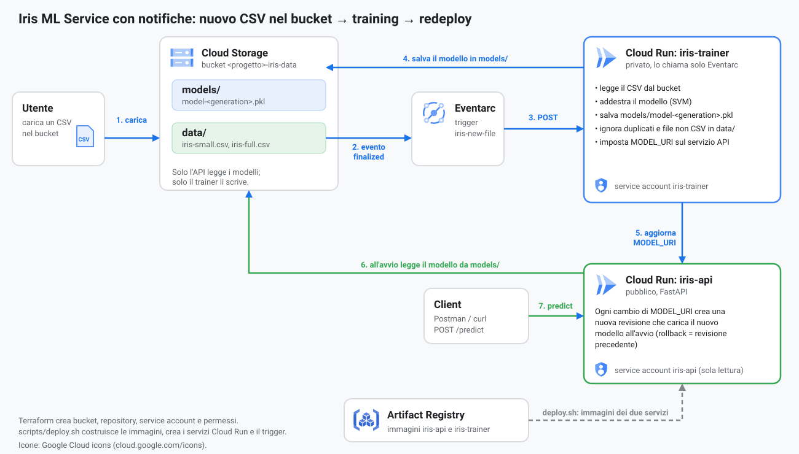
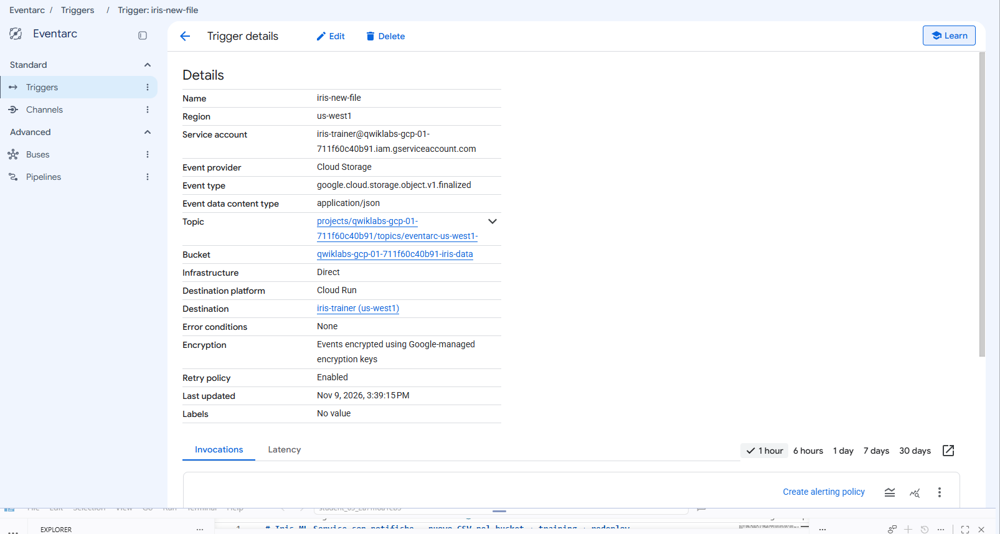
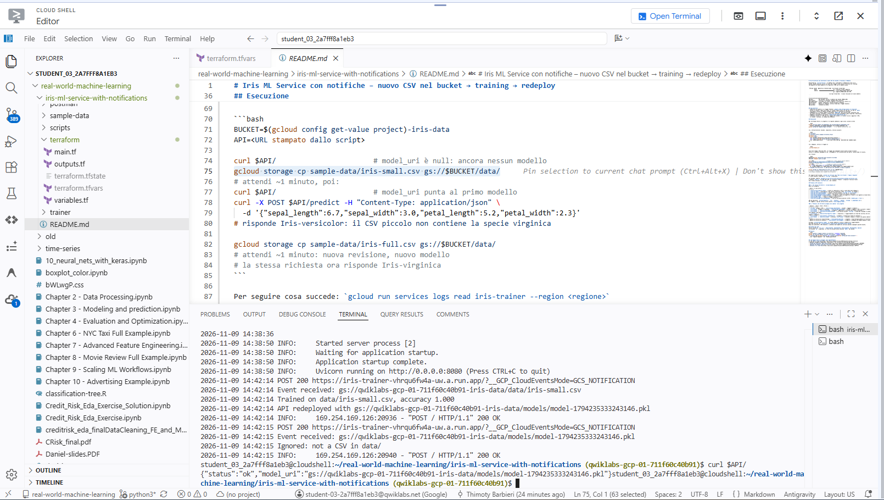
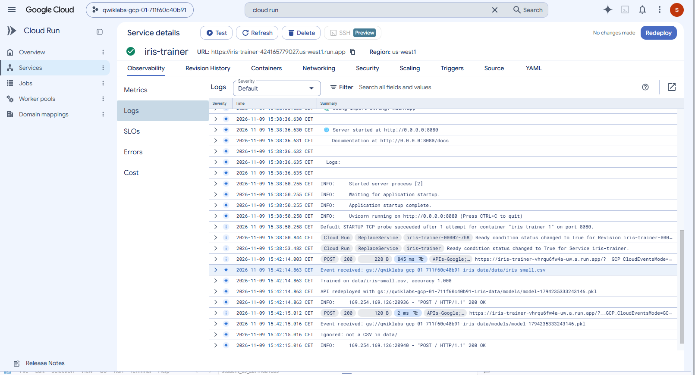
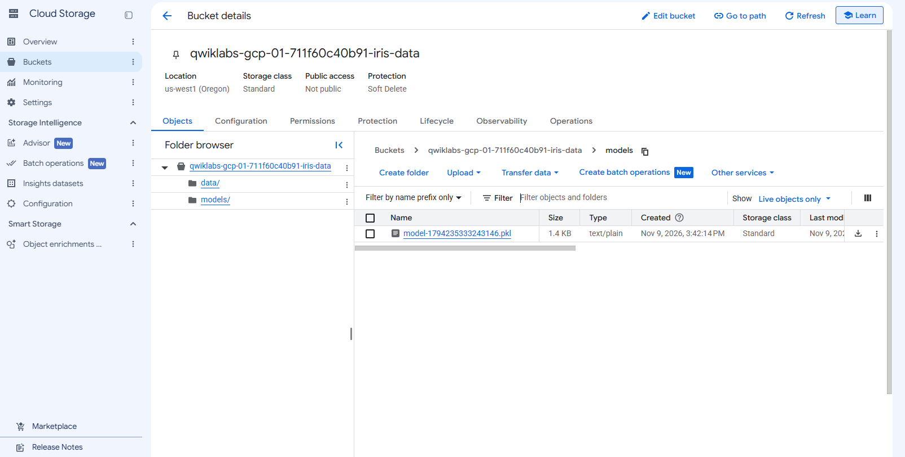

# Iris ML Service con notifiche – nuovo CSV nel bucket → training → redeploy

Evoluzione di `iris-ml-service`: il modello non è più dentro l'immagine ma vive in un
bucket. Quando qualcuno carica un nuovo CSV, Google Cloud avvisa un servizio di training
che addestra un nuovo modello e fa ripartire l'API con il modello nuovo.



*Diagramma con le icone ufficiali di [Google Cloud](https://cloud.google.com/icons).*

```
 CSV ──► bucket  ──notifica (Eventarc)──► iris-trainer (Cloud Run)
          data/                              │ 1. scarica il CSV e addestra
          models/  ◄─────────────────────────┤ 2. salva models/model-<data>.pkl
                                             │ 3. aggiorna MODEL_URI dell'API
                                             ▼
                                     iris-api (Cloud Run)  → nuova revisione col nuovo modello
```

```
iris-ml-service-with-notifications/
├── api/          API FastAPI: carica il modello dal bucket (MODEL_URI)
├── trainer/      servizio di training, chiamato dalla notifica
├── sample-data/  iris-small.csv (solo 2 specie) e iris-full.csv (tutte e 3)
├── terraform/    bucket, repository, service account e permessi
├── scripts/      deploy.sh: immagini, servizi Cloud Run, trigger Eventarc
└── postman/      richieste di prova
```

## Cosa mostrare
- **Notifica di bucket:** il trigger Eventarc `google.cloud.storage.object.v1.finalized`
  avvisa il trainer a ogni file nuovo. Il trainer ignora tutto ciò che non è un CSV in `data/`
  (altrimenti salvare un modello farebbe ripartire il training all'infinito).
- **Redeploy:** il trainer cambia la variabile `MODEL_URI` del servizio API: Cloud Run crea
  una nuova revisione. Rollback = tornare alla revisione precedente (vedi Cloud Run → Revisioni).
- **Modelli versionati** nel bucket (`models/model-<generation>.pkl`).
- **Permessi minimi:** l'API può solo leggere dal bucket; il trainer scrive e aggiorna l'API;
  il trainer è privato, lo chiama solo Eventarc.

Il trigger visto nella console (Eventarc → Trigger → `iris-new-file`): evento
`google.cloud.storage.object.v1.finalized` del bucket, destinazione il servizio Cloud Run
`iris-trainer`, chiamato con il service account `iris-trainer`. La *Retry policy* è attiva:
se il trainer non risponde in tempo Eventarc rimanda l'evento, per questo il trainer ignora i duplicati.



## Istruzioni per far girare l'esempio in Google Skills

**Lab di base:** avvia il lab
[Hello Cloud Run](https://www.skills.google/focuses/30842?parent=catalog).
Fornisce un progetto temporaneo (`qwiklabs-gcp-...`) con Cloud Shell, Docker e Terraform già pronti:
non serve completare le istruzioni del lab, basta usare il suo ambiente. Progetto e regione
cambiano a ogni avvio, per questo i comandi li leggono da `gcloud`.

**1. Prendi il codice e imposta progetto e regione** (dal Cloud Shell)

```bash
git clone -b python3 https://github.com/thimotyb/real-world-machine-learning.git
# se l'hai già clonato:  cd real-world-machine-learning && git pull
cd real-world-machine-learning/iris-ml-service-with-notifications

gcloud config get-value project                # deve essere il qwiklabs-gcp-... del lab
gcloud config set compute/region us-east1      # la regione indicata dal lab
```

**2. Abilita le API** (nel lab Terraform non può farlo)

```bash
gcloud services enable run.googleapis.com artifactregistry.googleapis.com \
  eventarc.googleapis.com pubsub.googleapis.com storage.googleapis.com
```

Aspetta 2-3 minuti: Eventarc crea il suo agente di servizio e i permessi impiegano un po' a
propagarsi. Se il trigger viene creato subito dopo, può fallire la prima volta con
`storage.buckets.get denied`: al secondo tentativo funziona.

**3. Terraform** (bucket, repository, service account, permessi)

```bash
cd terraform
cp terraform.tfvars.example terraform.tfvars
terraform init
terraform apply \
  -var "project_id=$(gcloud config get-value project)" \
  -var "region=$(gcloud config get-value compute/region)" \
  -var "enable_apis=false"       # le API sono già abilitate dal passo 2
cd ..
```

Controlla il piano (11 risorse da creare, nessuna da distruggere) e rispondi `yes`.

**4. Immagini, servizi Cloud Run e trigger**

```bash
./scripts/deploy.sh
```

Costruisce e carica le due immagini (alcuni minuti) e alla fine stampa `API URL`: copialo.

**5. Demo**

```bash
BUCKET=$(gcloud config get-value project)-iris-data
API=<URL stampato dallo script>

curl $API/                       # "model_uri": null: ancora nessun modello
gcloud storage cp sample-data/iris-small.csv gs://$BUCKET/data/
# attendi 30-60 secondi, poi:
curl $API/                       # model_uri punta al primo modello
curl -X POST $API/predict -H "Content-Type: application/json" \
  -d '{"sepal_length":6.7,"sepal_width":3.0,"petal_length":5.2,"petal_width":2.3}'
# risponde Iris-versicolor: il CSV piccolo non contiene la specie virginica

gcloud storage cp sample-data/iris-full.csv gs://$BUCKET/data/
# attendi 30-60 secondi: nuova revisione, nuovo modello
# la stessa richiesta ora risponde Iris-virginica
```

Nella console: Cloud Run → `iris-api` → Revisioni (una nuova a ogni caricamento).
Per i log: `gcloud run services logs read iris-trainer --region <regione>`.

Esempio di esecuzione in un lab Google Skills: i log del trainer mostrano l'evento per
`iris-small.csv`, l'addestramento, il modello salvato nel bucket e l'aggiornamento dell'API;
un secondo dopo arriva l'evento del file `.pkl` appena creato, che viene ignorato.
Il `curl $API/` finale conferma che l'API usa il nuovo modello (`model_uri` punta al `.pkl`).



Gli stessi log nella console, in Cloud Run → `iris-trainer` → Osservabilità → Log: le due richieste
`POST 200` sono l'evento del CSV e quello del modello appena salvato (ignorato).



Il bucket dopo il primo caricamento: la cartella `data/` contiene il CSV, la cartella `models/`
il modello creato dal trainer (`model-<generation>.pkl`).



Con Postman: importa `postman/iris-ml-service-with-notifications.postman_collection.json`
e imposta `base_url` all'URL dell'API (la richiesta "Predict - virginica" fallisce finché
non è stato caricato `iris-full.csv`, ed è voluto).

**Se qualcosa non va**

| Sintomo | Cosa controllare |
|---|---|
| `403` su `google_project_iam_member` o `google_service_account` in Terraform | l'utente del lab non ha abbastanza diritti sul progetto (vedi "Permessi GCP necessari") |
| `Permission denied on resource project` | l'id del progetto è quello di un lab precedente: usa `gcloud config get-value project` |
| `Permission denied while using the Eventarc Service Agent` alla creazione del trigger | i permessi dell'agente di Eventarc si stanno propagando: `deploy.sh` riprova da solo per ~5 minuti; altrimenti aspetta e ricrea solo il trigger (comando `gcloud eventarc triggers create` dello script) |
| Dopo il caricamento non succede nulla per più di 2-3 minuti | `gcloud eventarc triggers list --location <regione>` e i log del trainer |
| Più revisioni per un solo caricamento | il trainer ha ricevuto l'evento due volte; dovrebbe ignorare i duplicati, segnalalo |

## Permessi GCP necessari

### 1. Chi lancia Terraform e `scripts/deploy.sh`
Ruoli sul progetto:

| Ruolo | A cosa serve |
|---|---|
| `roles/artifactregistry.admin` | creare il repository e fare il push delle due immagini |
| `roles/run.admin` | distribuire i due servizi Cloud Run e dare `run.invoker` al trainer |
| `roles/iam.serviceAccountAdmin` | creare i service account `iris-api` e `iris-trainer` |
| `roles/iam.serviceAccountUser` | usare i due service account nei servizi Cloud Run |
| `roles/resourcemanager.projectIamAdmin` | assegnare i ruoli di progetto al trainer e all'agente di Cloud Storage |
| `roles/storage.admin` | creare il bucket e i suoi permessi |
| `roles/eventarc.admin` | creare il trigger Eventarc |
| `roles/serviceusage.serviceUsageAdmin` | solo se Terraform abilita le API (`enable_apis = true`) |

API da abilitare: `artifactregistry`, `run`, `eventarc`, `pubsub`, `storage` (`.googleapis.com`).
Per leggere i log dei servizi serve inoltre `roles/logging.viewer`.

### 2. Permessi che Terraform assegna alle identità del progetto

| Identità | Ruolo | Dove | Perché |
|---|---|---|---|
| `iris-api` (esegue l'API) | `roles/storage.objectViewer` | bucket | leggere il modello |
| `iris-trainer` (esegue il training) | `roles/storage.objectAdmin` | bucket | leggere i CSV e scrivere i modelli |
| `iris-trainer` | `roles/run.developer` | progetto | aggiornare il servizio API (nuova revisione) |
| `iris-trainer` | `roles/iam.serviceAccountUser` | sul service account `iris-api` | Cloud Run richiede il permesso "act as" sull'identità dell'API |
| `iris-trainer` | `roles/artifactregistry.reader` | repository | l'aggiornamento di Cloud Run verifica che chi aggiorna possa leggere l'immagine |
| `iris-trainer` | `roles/eventarc.eventReceiver` | progetto | ricevere gli eventi di Eventarc |
| `iris-trainer` | `roles/run.invoker` | servizio `iris-trainer` | Eventarc chiama il trainer con questa identità (lo imposta `deploy.sh`) |
| agente di servizio di Cloud Storage | `roles/pubsub.publisher` | progetto | Cloud Storage pubblica le notifiche tramite Pub/Sub |
| agente di servizio di Eventarc | `roles/eventarc.serviceAgent` | progetto | assegnato da Google quando si abilita l'API |

Se manca `artifactregistry.reader` il trainer addestra e salva il modello ma l'aggiornamento
dell'API fallisce con `artifactregistry.repositories.downloadArtifacts denied`.
Dopo aver abilitato l'API Eventarc, i permessi dell'agente di servizio possono impiegare qualche minuto.

## Formato del CSV
Stesse colonne di `Iris.csv`: `SepalLengthCm, SepalWidthCm, PetalLengthCm, PetalWidthCm, Species`
(la colonna `Id` è ignorata). Il file va caricato nella cartella `data/` del bucket.

## Pulizia
```bash
gcloud eventarc triggers delete iris-new-file --location <regione>
gcloud run services delete iris-api iris-trainer --region <regione>
cd terraform && terraform destroy -var "project_id=$(gcloud config get-value project)" \
  -var "region=<regione>" -var "enable_apis=false"
```

## Lab Google Skills collegati (per approfondire)
Il lab [Hello Cloud Run](https://www.skills.google/focuses/30842?parent=catalog) fornisce
l'ambiente (progetto temporaneo, Cloud Shell). Per la parte di notifiche dal bucket:
- [Cloud Run Functions: Qwik Start](https://www.skills.google/focuses/49757?parent=catalog) (GSP1089)
- [Develop and Deploy Cloud Run Functions](https://www.skills.google/focuses/57552?parent=catalog)
- [Eventarc for Cloud Run](https://www.skills.google/focuses/15657?parent=catalog) (GSP773)
