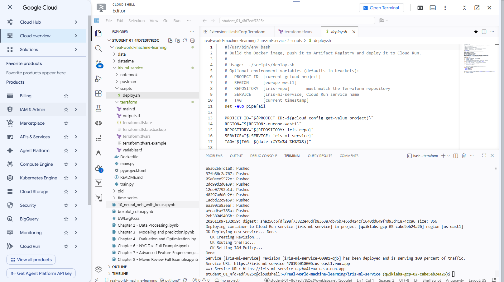

# Iris ML Service – dal notebook alla produzione

Esempio didattico: un modello scikit-learn addestrato in un notebook diventa
un'API FastAPI, poi un container pronto per Artifact Registry e Cloud Run.

```
iris-ml-service/
├── notebook/   notebook originale (addestramento + Flask)
├── train.py    addestra il modello e crea model.pkl   (celle 1-13 del notebook)
├── main.py     API FastAPI                             (celle Flask del notebook)
├── pyproject.toml   dipendenze + entrypoint FastAPI
├── Dockerfile
├── terraform/  API + repository Artifact Registry
├── scripts/    deploy.sh: build, push, deploy su Cloud Run
└── postman/    collection per le chiamate di prova
```

## 1. Il notebook
Apri `notebook/Using_Pickle_and_Flask_for_ML_models.ipynb` in VS Code
(estensioni *Python* e *Jupyter*). Punti da far notare:
- addestramento e API sono mescolati nello stesso file;
- il modello viene ricaricato a ogni richiesta;
- Flask gira nel notebook e serve ngrok per raggiungerlo.

## 2. Esecuzione locale

```bash
python3 -m venv .venv
source .venv/bin/activate
pip install uv
uv pip install -r pyproject.toml   # legge le dipendenze da pyproject.toml

python train.py                # crea model.pkl
fastapi dev                    # avvia l'API su http://localhost:8000 (porta 8000, reload automatico)
```

Documentazione interattiva generata da FastAPI: <http://localhost:8000/docs>

## 3. Container

```bash
docker build -t iris-ml-service .
docker run --rm -p 8000:8080 iris-ml-service
```

Il modello viene addestrato durante la build, così il pickle è sempre
compatibile con la versione di scikit-learn dell'immagine.
Cloud Run imposta da solo la variabile `PORT`.

## 4. Prove con Postman
Importa `postman/iris-ml-service.postman_collection.json`.
La variabile `base_url` vale `http://localhost:8000`: per provare il servizio
su Cloud Run sostituiscila con l'URL del servizio.

Oppure da terminale:

```bash
curl -X POST http://localhost:8000/predict \
  -H "Content-Type: application/json" \
  -d '{"sepal_length":5.1,"sepal_width":3.4,"petal_length":1.3,"petal_width":0.2}'
```

## 5. Deploy su Google Cloud (Terraform + script)

Prerequisiti: `gcloud auth login`, Docker e Terraform installati.

**a) Infrastruttura con Terraform** (abilita le API e crea il repository Artifact Registry):

```bash
cd terraform
cp terraform.tfvars.example terraform.tfvars   # imposta project_id
terraform init
terraform apply
cd ..
```

**b) Push dell'immagine e deploy su Cloud Run:**

```bash
./scripts/deploy.sh
```

Lo script costruisce l'immagine, la carica su Artifact Registry, la distribuisce
su Cloud Run e stampa l'URL del servizio: usalo come `base_url` in Postman.
Ogni esecuzione crea una nuova revisione (utile per mostrare rollback e revisioni).
Si possono cambiare i valori con variabili d'ambiente, ad esempio
`PROJECT_ID=... REGION=... ./scripts/deploy.sh`.

### Lab Google Skills usato per l'esempio
L'esempio è stato provato dentro il lab
[Hello Cloud Run](https://www.skills.google/focuses/30842?parent=catalog):
fornisce il progetto temporaneo, il Cloud Shell e Cloud Run già pronti.

### Nei lab Google Skills
Il progetto e la regione cambiano a ogni avvio del lab. Prima di tutto:

```bash
gcloud services enable run.googleapis.com artifactregistry.googleapis.com
gcloud config set compute/region us-east1      # la regione indicata dal lab

cd terraform
cp terraform.tfvars.example terraform.tfvars
terraform init
terraform apply \
  -var "project_id=$(gcloud config get-value project)" \
  -var "region=$(gcloud config get-value compute/region)" \
  -var "enable_apis=false"                     # le API le abilita già il comando sopra
cd ..
./scripts/deploy.sh                            # legge progetto e regione da gcloud
```

Se Terraform dà "Permission denied on resource project", l'id del progetto è
quello di un lab precedente: usa sempre `gcloud config get-value project`.

Esempio di deploy riuscito in un lab Google Skills (Cloud Shell, `us-east1`):



## Permessi GCP necessari

Chi lancia Terraform e `scripts/deploy.sh` (utente o service account) ha bisogno di questi ruoli sul progetto:

| Ruolo | A cosa serve |
|---|---|
| `roles/artifactregistry.admin` | creare il repository (Terraform) e fare il push dell'immagine |
| `roles/run.admin` | distribuire il servizio Cloud Run e renderlo pubblico (`--allow-unauthenticated`) |
| `roles/iam.serviceAccountUser` | permettere a Cloud Run di usare il service account predefinito (Compute Engine) |
| `roles/serviceusage.serviceUsageAdmin` | solo se Terraform abilita le API (`enable_apis = true`); non serve se le API sono già abilitate |

API da abilitare: `artifactregistry.googleapis.com` e `run.googleapis.com`.

Nei lab Google Skills lo studente ha già questi permessi (ruolo Owner/Editor sul progetto temporaneo),
ma non può elencare/abilitare le API con Terraform: per questo si usa `enable_apis = false`.
Se il progetto ha una policy che vieta l'accesso pubblico, `--allow-unauthenticated` fallisce.

## 6. Passi successivi (corso)
Artifact Registry (push dell'immagine) → Cloud Run (deploy) → Cloud Build (automazione).
